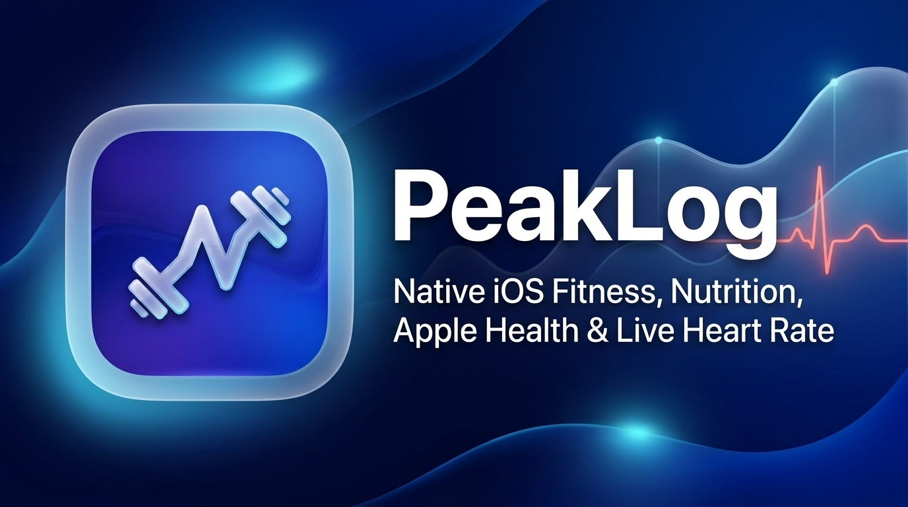
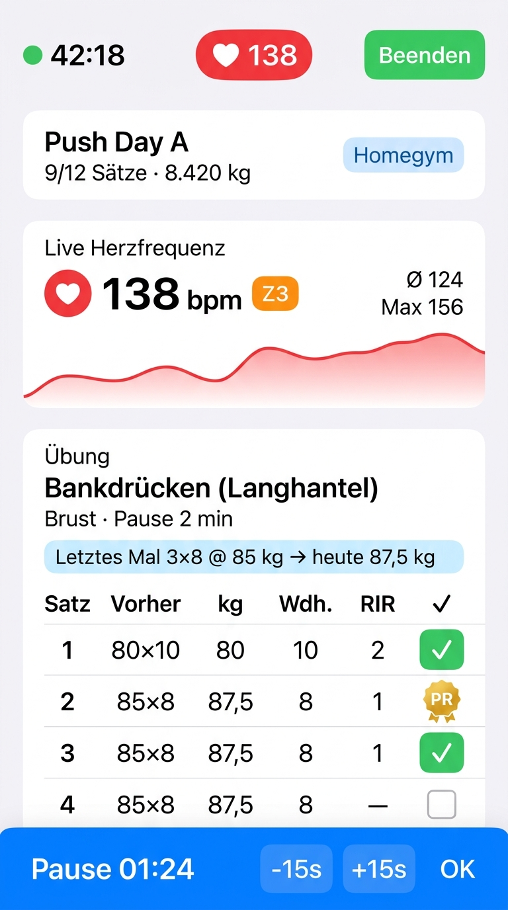
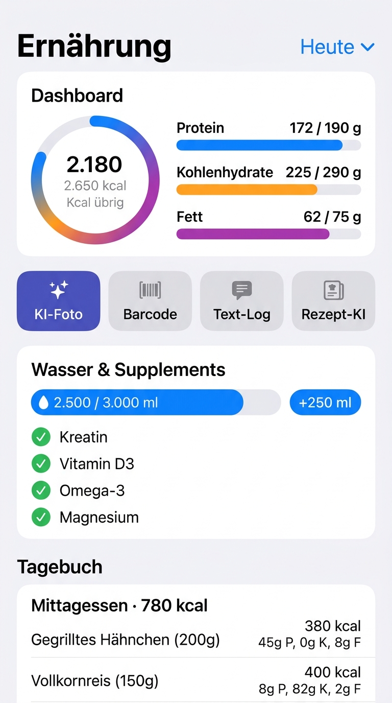
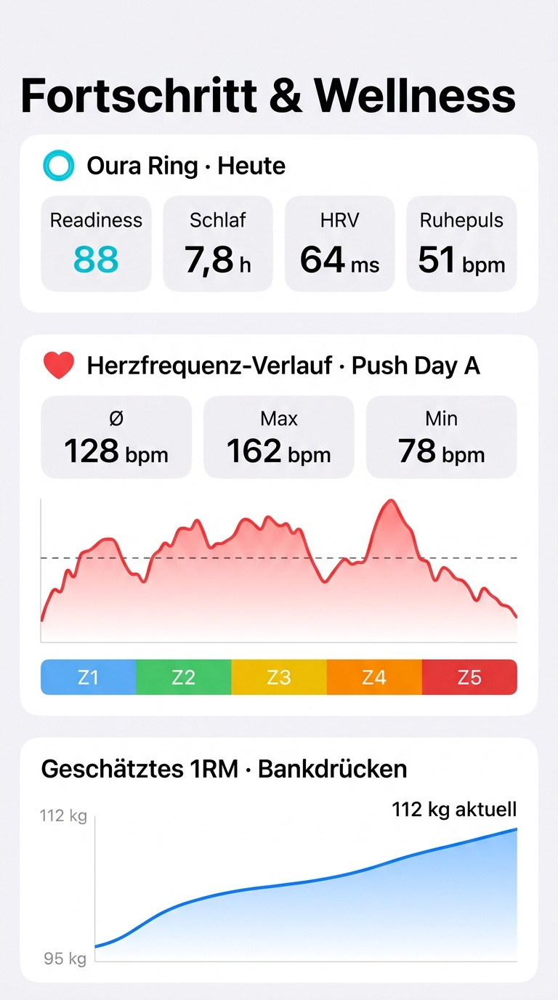

<p align="center">
  
</p>

<h1 align="center">PeakLog</h1>

<p align="center">
  <strong>Native iOS Fitness-, Ernährungs-, Wellness- & Live-Herzfrequenz-App</strong><br/>
  100 % lokal (SQLite/GRDB) · Dynamic Island · Apple Health · Kein Abo · Keine Cloud-Pflicht · iOS 16.5+ & TrollStore
</p>

<p align="center">
  
  
  
  
  <a href="https://github.com/lukaswalzik/PeakLog/actions/workflows/build-ipa.yml">
    
  </a>
</p>

---

## Vorschau

<table>
  <tr>
    <td align="center" width="33%">
      <br/>
      <sub><b>Aktives Training & Live-Puls</b><br/>Apple Health / UDP-HF, Sparkline, Progression, RIR, PR-Badges & Pausentimer</sub>
    </td>
    <td align="center" width="33%">
      <br/>
      <sub><b>Ernährung & KI-Scanner</b><br/>Kalorien, Makros, Mistral-Foto/Barcode, Wasser & Supplements</sub>
    </td>
    <td align="center" width="33%">
      <br/>
      <sub><b>Analyse, HF-Charts & Oura Ring</b><br/>Readiness, Schlaf, HRV, Puls-Kurve, HF-Zonen & 1RM-Trends</sub>
    </td>
  </tr>
</table>

---

## Funktionsumfang

### Krafttraining, Dynamic Island & Smart Coaching
- **Dynamic Island & Sperrbildschirm Live Activity (`ActivityKit`):** Zeigt Pausentimer-Countdown, Live-Herzfrequenz + Zone, aktuelle Übung und Satz-Fortschritt live in der **Dynamic Island** (iPhone 14 Pro) und auf dem Sperrbildschirm – inkl. 1-Tap-Sprung zurück ins laufende Workout.
- **Home-Screen & Sperrbildschirm Widgets (`WidgetKit`):**
  - **Ernährung & Makros** *(Klein, Mittel + Sperrbildschirm-Ring, -Rechteck & -Inline)*: Kalorien-Ring, Protein, Carbs, Fett & Wasser heute.
  - **Training & Streak** *(Klein, Mittel + Sperrbildschirm)*: Wochen-Streak, 7-Tage-Wochenaktivität, Wochenvolumen, Level, Readiness & nächste Routine.
  - **Wasser & Supplements** *(Klein + Sperrbildschirm)*: Trinkziel-Fortschritt & abgehakte Supplements heute.
- **Routinen & Vorlagen:** Eigene Trainingspläne erstellen, sortieren, per **Deload-Modus** (−20 % Gewicht, reduziertes Volumen) starten und nach dem Training direkt aktualisieren.
- **Aktives Workout-Logging:** Vorherige Sätze pro Gym im Blick, Satztypen (`Arbeitssatz`, `Aufwärmsatz`, `Dropset`, `Muskelversagen`), **RIR-Tracking**, **Supersätze**, Aufwärmsatz-Generator, **interaktiver Scheibenrechner (Plate Calculator)** mit Hantel-Vorschau, Gym-Scheiben-Konfiguration & Aufwärm-Leiter sowie schnelles Ersetzen besetzter Geräte.
- **Smart Progression & Live-PRs:** Automatische Double-Progression-Empfehlungen, Live-PR-Erkennung (geschätztes 1RM nach Epley), automatischer **Pausentimer** inkl. lokaler Benachrichtigungen und minimierbarem Workout-Banner.
- **Multi-Gym-Support & Übungsbibliothek:** Mehrere Studios/Homegyms verwalten, Gym-spezifische Geräte-/Setup-Notizen speichern, **72 integrierte Übungs-Illustrationen** (Maschinen, Kabelzug, Lang-/Kurzhantel & Körpergewicht) + eigene Übungsfotos.
- **Workout-Recap-Cards:** Teilbare Abschlusskarten mit Dauer, Volumen, Sätzen, neuen Bestleistungen und Herzfrequenz-Zusammenfassung.

### Live-Herzfrequenz (Apple Health & UDP) & Cardio
- **Apple Health (HealthKit):** Live-Herzfrequenz-Streaming in Echtzeit (z. B. von AirPods HF Bridge oder Apple Watch), Tagesübersicht (Schritte, Aktivitätskalorien, Ruhepuls, HRV), 1-Tap-Gewichtsimport sowie automatischer Export abgeschlossener Kraft- & Cardio-Workouts in Apple Health.
- **Lokaler Live-HF-Empfänger (`127.0.0.1:49153`):** Empfängt zusätzlich lokale UDP-Pakete (IPv4/IPv6, UTF-8 ASCII-BPM `30–240`, ca. 1×/Sekunde) inkl. integriertem Selbsttest & Roh-Diagnose.
- **Im Kraft-Workout:** Live-Puls in Toolbar, Banner, Dynamic Island und eigener Live-HF-Karte mit aktueller HF-Zone, Ø-/Max-Puls und Echtzeit-Sparkline; alle Messpunkte werden automatisch gespeichert und im Trainingsverlauf als **Swift-Charts-Kurve** mit HF-Zonen-Verteilung visualisiert.
- **Cardio & Live-Cardio-Timer:** 10 Sportarten, 5 Herzfrequenzzonen (`Z1–Z5`), automatische **Auto-Zonen-Umschaltung** per Live-Puls sowie Speicherung von Ø- und Max-Herzfrequenz.
- **Cardio-Trainingspläne:** Eigene Cardio-Pläne erstellen, bearbeiten & duplizieren (inkl. vorinstalliertem gelenkschonendem **Zone-2 Grundfitness-Starterplan** für Laufband-Incline-Walk & Ergometer), Wochenziel-Fortschritt, 1-Tap-Start direkt in den Live-Timer mit Zielzeit-Balken & Echtzeit-Zielzonen-Coaching („Im Zielbereich“ / „Etwas zügiger“ / „Etwas ruhiger“).

### Ernährung, Wasser & Supplements
- **Makro- & Mikronährstoffe:** Kalorien, Protein, Kohlenhydrate, Fett sowie Ballaststoffe, Zucker, Salz, Vitamin C, Kalzium und Eisen.
- **Schnelles Logging:** **Open Food Facts**-Suche, integrierter **Barcode-Scanner**, eigene Lebensmittel, Favoriten, gespeicherte Mahlzeiten, Tages-Templates und „Mahlzeit von gestern kopieren“.
- **Bedarfs- & TDEE-Rechner:** Mifflin-St-Jeor-Rechner, **adaptiver TDEE** aus Gewichts- & Kalorienverlauf, Makro-Helfer und 7-Tage-Ernährungstrend.
- **Hydration & Supplements:** Täglicher Wasser-Tracker mit Tagesziel sowie abhakbare Supplement-Liste (Kreatin, Vitamin D3+K2, Omega-3, Magnesium & eigene).

### Mistral KI-Assistent *(optional, Bring Your Own Key)*
- **KI-Foto-Scanner (Vision):** 1-Tap-Kamera-Scan für Teller oder Nährwertetiketten (OCR) mit automatischer Analyse nach Aufnahme, Portions-Skalierer (`0,5×–2×`), Inline-Bearbeitung je Zutat und optionalem Speichern als Mahlzeit-Vorlage.
- **Freitext-Logging & Rezept-Chef:** Mahlzeiten in natürlicher Sprache eintragen oder Rezepte passend zu den offenen Rest-Makros generieren lassen.
- **KI-Coach & Trainingsplan-Generator:** Datenbasierte Trainings-/Ernährungsanalysen, Post-Workout-Feedback und komplette Trainingspläne per 1-Tap als Routinen speicherbar (Mistral Small 4 / Large 4).

### Wellness, Oura Ring & Fortschritt
- **Oura Ring (API v2, OAuth2):** Synchronisiert Readiness, Schlaf, HRV, Ruhepuls, Aktivität, Stress, SpO2 und Workouts direkt in die App.
- **Körperfortschritt:** Körpergewicht mit **interaktivem Vorher/Nachher-Wisch-Slider** & Nebeneinander-Vergleich (inkl. Gewichts-, Zeit- & **US-Navy-KFA-Differenz**, Thumbnail-Auswahlleiste & teilbarer PeakLog Transformation Card), Körpermaße (Brust, Taille, Hals, Arm, Oberschenkel) inkl. **US-Navy-KFA & FFMI**.
- **Motivation & Analyse:** Fortschritts-Dashboard (1RM- & Gewichtstrends), wöchentliche Muskel-Heatmap, Kraftstandards, **PeakLog Wrapped**, Trainingskalender, Level/XP/Streaks, Meilensteine und lokale Erinnerungen.

### Datenschutz, Import & Lokales Backup
- **100 % Local-First:** Alle Daten liegen in einer lokalen SQLite-Datenbank auf dem iPhone; API-Keys und OAuth-Tokens werden lokal gespeichert und nur bei Nutzung direkt an die jeweilige API (Mistral / Oura / Open Food Facts) gesendet.
- **Strong-App CSV-Import:** Direkter Umstieg aus der Strong-App (`strong.csv`, v5 & v6, EN/DE, `,` oder `;`, kg & lbs) mit Vorschau, automatischer Übungszuordnung, RPE→RIR-Konvertierung und Duplikat-Erkennung – bestehende Daten bleiben erhalten.
- **JSON-Komplett-Backup:** Export & Import aller Trainings-, Ernährungs-, Herzfrequenz- und Wellness-Daten — optional inkl. aller eigenen Übungs- und Fortschrittsfotos.

---

## Live-Herzfrequenz per Apple Health oder UDP

- **Apple Health:** Unter **Profil → Apple Health** verbinden. Neue Herzfrequenz-Werte (z. B. von AirPods HF Bridge oder Apple Watch) erscheinen automatisch im Workout, im Live-Cardio-Timer und in der Dynamic Island.
- **Lokales UDP (optional):** Lauscht zusätzlich auf `0.0.0.0:49153` & `[::]:49153` (UTF-8 ASCII-BPM `30–240`, z. B. `"74"`, inkl. 1-Tap-Selbsttest unter **Profil → Live-Herzfrequenz (UDP)**).

```bash
printf "132" | nc -u -w1 127.0.0.1 49153
```

---

## Installation (TrollStore / Sideloading)

### Option 1: Vorgefertigte `.ipa` aus GitHub Actions
1. Öffne den Tab **[Actions](https://github.com/lukaswalzik/PeakLog/actions/workflows/build-ipa.yml)** und wähle den letzten erfolgreichen Lauf von **Build Unsigned IPA**.
2. Lade das Artifact **`PeakLog-ipa`** herunter und entpacke die `.zip`-Datei.
3. Installiere `PeakLog.ipa` direkt über **TrollStore** (HealthKit-, App-Group-Entitlements & Widget-/Live-Activity-Extension sind bereits ad-hoc eingebettet).

> **Wichtig bei Updates:** Die feste Bundle-ID `com.local.strongtracker` bleibt unverändert, sodass deine lokale Datenbank, Fotos und Einstellungen beim Drüberinstallieren vollständig erhalten bleiben.

### Option 2: Selbst mit XcodeGen bauen (macOS)

Voraussetzungen: macOS mit Xcode (iOS 16.5+ SDK) und [XcodeGen](https://github.com/yonaskolb/XcodeGen).

```bash
git clone https://github.com/lukaswalzik/PeakLog.git
cd PeakLog

brew install xcodegen
xcodegen generate
open StrongTracker.xcodeproj
```

---

## Tech-Stack & Architektur

- **UI:** SwiftUI (strikt kompatibel ab **iOS 16.5**), `NavigationStack`, `ObservableObject` / `@StateObject` / `@EnvironmentObject`
- **Widgets, Live Activities & Dynamic Island:** `WidgetKit` + `ActivityKit` Extension (`LiveActivityExtension/`) mit App-Group-Sync (`group.com.local.strongtracker`)
- **Health & Sensorik:** `HealthKit` (`HKAnchoredObjectQuery`, `HKWorkoutBuilder`) & `Darwin` Dual-Stack UDP Socket (`DispatchSourceRead`)
- **Diagramme:** Swift Charts
- **Persistenz:** [GRDB.swift](https://github.com/groue/GRDB.swift) (SQLite mit versionierten Migrationen `v1`–`v12`)
- **Projektverwaltung:** [XcodeGen](https://github.com/yonaskolb/XcodeGen) ([`project.yml`](project.yml)) – keine `.xcodeproj`-Dateien im Repository
- **CI/CD:** GitHub Actions ([`.github/workflows/build-ipa.yml`](.github/workflows/build-ipa.yml)) baut bei jedem Push auf `main` automatisch `PeakLog.ipa`

```text
Sources/
├── App/                  # StrongTrackerApp, RootTabView & ActiveWorkoutBanner
├── Database/             # AppDatabase, Migrations (v1–v12), SeedData, SeedFoods
├── Models/               # Workout, HeartRateSample, CardioSession, Nutrition, Wellness, BackupPayload
├── Services/             # ActiveWorkoutManager, HealthKitService, HeartRateReceiver, WorkoutLiveActivityManager, WidgetDataSyncManager, StrongCSVImportService, MistralAI, Oura, Backup
├── Shared/               # Theme, Formatters, 1RM-Rechner, WorkoutActivityAttributes, PeakLogWidgetSnapshot, Komponenten
└── Features/             # Start, ActiveWorkout, History, Exercises, Cardio, Nutrition, Bodyweight, Wellness, AI, Gyms, Profile

LiveActivityExtension/    # Dynamic Island, Lock Screen Live Activity & Home/Lock Screen Widgets (WidgetKit)
```